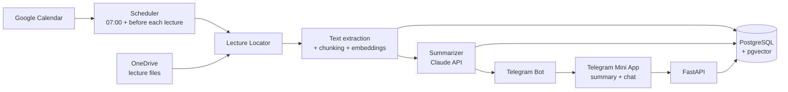

# lecture-prep

[](https://github.com/DorAvissar/lecture-prep/actions/workflows/ci.yml)

A personal assistant that gets you ready for every lecture. Each morning it reads your Google Calendar,
finds the day's lectures, pulls the previous and current lecture material from OneDrive, and sends you on
Telegram:

- **A recap** of the previous lecture: short, focused on what you need to remember.
- **A prep brief** for today's lecture: the big picture and the *intuition* behind each idea, without
  drowning in details.
- **A chat** where you can ask questions, answered in the context of that lecture's material.

> **Status:** early development. See the [roadmap](#roadmap).

## Architecture



## Tech stack

| Area | Choice | Why |
|---|---|---|
| Language / API | Python 3.11, FastAPI | Strong AI/data ecosystem, typed, async-ready |
| Packaging | [uv](https://docs.astral.sh/uv/) | Fast, reproducible installs via `uv.lock` |
| Database | PostgreSQL + pgvector | One store for relational data and vector search |
| LLM | Claude API | Summaries and lecture-aware Q&A |
| Delivery | Telegram Bot + Mini App | Free push notifications and a custom UI without an app store |
| Quality | pytest, ruff, pre-commit, GitHub Actions | Tests and lint on every commit and push |

## Getting started

Prerequisites: [uv](https://docs.astral.sh/uv/getting-started/installation/) and
[Docker](https://www.docker.com/products/docker-desktop/).

```bash
git clone https://github.com/DorAvissar/lecture-prep.git
cd lecture-prep
uv sync                       # create .venv and install dependencies
uv run pre-commit install     # run ruff before every commit
cp .env.example .env          # then fill in real values
docker compose up -d          # start Postgres + pgvector
uv run uvicorn lecture_prep.main:app --reload
```

Then open <http://localhost:8000/health> or the interactive API docs at <http://localhost:8000/docs>.

### Running checks

```bash
uv run pytest                 # tests
uv run ruff check .           # lint
uv run ruff format .          # format
```

## Project structure

```
src/lecture_prep/   application code
tests/              pytest test suite
.github/workflows/  CI pipeline
```

## Roadmap

- [x] Project skeleton: FastAPI, tests, lint, CI, local database
- [ ] Data model: courses, lectures, summaries, chunks (SQLAlchemy + Alembic)
- [ ] Calendar sync: today's lectures from Google Calendar
- [ ] OneDrive client: list and download lecture files via Microsoft Graph
- [ ] Lecture locator: find the previous and current lecture for a course
- [ ] Processing: text extraction from PDF/PPTX, chunking, embeddings
- [ ] Summarizer: recap and prep prompts, with quality evals
- [ ] Scheduler + Telegram bot
- [ ] Telegram Mini App with lecture-aware chat (RAG)
- [ ] Cloud deployment
