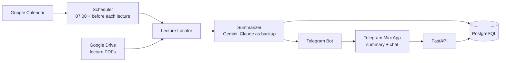

# lecture-prep

[](https://github.com/DorAvissar/lecture-prep/actions/workflows/ci.yml)

A personal assistant that gets you ready for every lecture. Each morning it reads your Google Calendar,
finds the day's lectures, pulls the previous and current lecture material from Google Drive, and sends you on
Telegram:

- **A recap** of the previous lecture: short, focused on what you need to remember.
- **A prep brief** for today's lecture: the big picture and the *intuition* behind each idea, without
  drowning in details.
- **A chat** where you can ask questions, answered in the context of that lecture's material.

> **Status:** early development. See the [roadmap](#roadmap).

## Architecture



## Tech stack

| Area | Choice | Why |
|---|---|---|
| Language / API | Python 3.11, FastAPI | Strong AI/data ecosystem, typed, async-ready |
| Packaging | [uv](https://docs.astral.sh/uv/) | Fast, reproducible installs via `uv.lock` |
| Database | PostgreSQL | Courses, lectures and stored summaries |
| LLM | Gemini Pro, with Claude Sonnet 5.5 as backup | Read lecture PDFs directly; chosen by a blind comparison (below) |
| Delivery | Telegram Bot + Mini App | Free push notifications and a custom UI without an app store |
| Quality | pytest, ruff, pre-commit, GitHub Actions | Tests and lint on every commit and push |

## Getting started

Prerequisites: [uv](https://docs.astral.sh/uv/getting-started/installation/) and
[Docker](https://www.docker.com/products/docker-desktop/).

```bash
git clone https://github.com/DorAvissar/lecture-prep.git
cd lecture-prep
uv sync                       # create .venv and install dependencies
uv run pre-commit install     # run ruff before every commit
cp .env.example .env          # then fill in real values
docker compose up -d          # start Postgres + pgvector
uv run alembic upgrade head   # create / update the database tables
uv run uvicorn lecture_prep.main:app --reload
```

Then open <http://localhost:8000/health> or the interactive API docs at <http://localhost:8000/docs>.

### Running checks

```bash
uv run pytest                 # tests (needs the database from docker compose)
uv run ruff check .           # lint
uv run ruff format .          # format
uv run alembic check          # models and migrations are in sync
```

Database tests run the real migrations, then wrap every test in a transaction that is rolled back, so
they never leave data behind.

### Connecting Google

The calendar and the lecture files both come from Google, through one read-only sign-in
(`calendar.readonly` + `drive.readonly`).

1. In [Google Cloud Console](https://console.cloud.google.com/), create a project.
2. **APIs & Services → Library**: enable the *Google Calendar API* and the *Google Drive API*.
3. **Google Auth Platform → Get started**: audience *External*. Under **Audience**, add your own Gmail
   address as a test user.
4. **Clients → Create client**, type *Desktop app*. Download the JSON file and save it as
   `.secrets/google_client_secret.json` (git-ignored).
5. Sign in once - a browser window opens, and the token is saved to the git-ignored `.cache/` folder:

```bash
uv run python -m lecture_prep.google_api.login
```

> While the app's publishing status is *Testing*, Google expires the refresh token after 7 days. For a
> personal tool, set **Audience → Publish app** to *In production*; Google then shows an "unverified app"
> warning on the consent screen, which you can accept for your own account.

Lecture files live in Google Drive under `DRIVE_LECTURES_FOLDER` (default `Lectures`), one sub-folder per
course. With [Google Drive for desktop](https://www.google.com/drive/download/) that folder is a normal
folder on your computer.

### Courses and lecture files

Each course has a folder in Drive with a `הרצאות` (lectures) sub-folder. Only that sub-folder is read,
so tutorials can live next to it. A file's lecture number is the number after the word `הרצאה`
(`חדו״א 2- הרצאה 3.pdf`), or else the number its name starts with (`03 - Integrals.pdf`); files with the
same number belong to the same lecture. Only PDFs and native Google docs are used (save `.pptx` slides
as PDF).

```
Lectures/
  Calculus 2/
    הרצאות/
      חדו״א 2- הרצאה 1.pdf
      חדו״א 2- הרצאה 2.pdf
      חדו״א 2- הרצאה 3.pdf
    תרגולים/            <- ignored
```

Lectures are **counted, not guessed from the files**: you set the next lecture once, and every day the
course is on the calendar moves it one lecture forward. Events whose title contains `תרגול` are
tutorials and do not count.

List your courses in `courses.toml` (copy `courses.example.toml`), load them, and set where each one
stands:

```bash
uv run python -m lecture_prep.courses                    # load courses.toml
uv run python -m lecture_prep.courses next "חדו\"א 2" 5   # the next Calculus 2 lecture is lecture 5
```

If a lecture is cancelled but stays on the calendar, the count moves on anyway - run `next` again to
fix it.

### Lectures in a shared calendar

By default lectures are read from your own Google calendar. If they are in another calendar, for example
a university calendar in a different Google account, share it with the account you signed in with
(calendar **Settings → Share with specific people → See all event details**), accept the invitation, then
find its id and add it to `CALENDAR_IDS` in `.env`:

```bash
uv run python -m lecture_prep.google_api.calendars
```

```
CALENDAR_IDS=["primary", "<the shared calendar's id>"]
```

### Choosing the model

Summaries and chat go through one small interface (`llm.py`), so the provider is a setting:

```
LLM_PROVIDER=gemini               # or claude
LLM_FALLBACK_PROVIDER=claude      # answers whenever the main model fails; empty for no backup
LLM_FALLBACK_MODEL=claude-sonnet-5-5
```

The default came from a blind comparison on a real lecture: Gemini Pro, Claude Sonnet 5.5 and Claude
Opus 5.5 each wrote the same prep brief and recap, shown as A, B and C in random order. Gemini Pro was
preferred, then Sonnet, then Opus. Run one yourself (the page lands in the git-ignored `comparisons/`):

```bash
uv run python -m lecture_prep.compare "תכנות מערכות" 5
```

Gemini keys come from [Google AI Studio](https://aistudio.google.com) (`GEMINI_API_KEY`); a Gemini app
subscription does not include API access.

### Running a day

Put the model keys in `.env` (`GEMINI_API_KEY`, and `ANTHROPIC_API_KEY` for the backup), then:

```bash
uv run python -m lecture_prep.run_day               # today
uv run python -m lecture_prep.run_day 2026-11-02    # another day
```

For each lecture on the calendar it writes a recap of the previous lecture and a prep brief for today's,
stores them, and prints them. Stored summaries are reused, so a second run costs nothing.

### Connecting Telegram

1. In Telegram, open **@BotFather**, send `/newbot`, and put the token it gives you in `.env` as
   `TELEGRAM_BOT_TOKEN`.
2. Send your new bot any message, then print your chat id and put it in `.env` as `TELEGRAM_CHAT_ID`:

```bash
uv run python -m lecture_prep.telegram.chat_id
```

### Sending on schedule

```bash
uv run python -m lecture_prep.tick
```

Run it every 15 minutes (a cron job in the cloud). From `MORNING_HOUR` (default 07:00) it sends one
message with the day's lectures, once; `REMINDER_MINUTES` (default 30) before each lecture it sends a
short reminder, once. Each lecture has a button that opens the Mini App. Sent messages are recorded in the database, so extra runs are harmless
and a failed run is retried by the next one.

### The Mini App

The buttons open a small page inside Telegram with three tabs: the prep brief for today's lecture, the
recap of the previous one, and a chat that answers questions with both lectures' PDFs as context. It is
one HTML file served by the FastAPI app (`/app`), with no front-end build.

- Telegram opens Mini Apps only over https, so buttons appear once `PUBLIC_URL` is set (after deploying).
- Every API call carries Telegram's signed init data, checked against the bot token; only the bot's owner
  (`TELEGRAM_CHAT_ID`) gets an answer. In development the page also opens in a normal browser:
  <http://localhost:8000/app?course=1&lecture=5>.
- Mixed Hebrew and English is kept readable by isolating every English run and code span as its own
  left-to-right segment inside the right-to-left page.
- The chat is not stored; closing the page starts a new conversation.

### Deploying to Railway

One Docker image runs as two [Railway](https://railway.com) services next to a Postgres database:

| Service | Start command | Schedule |
|---|---|---|
| `web` | the image's default: migrations, then the API and Mini App | always on, with a public domain |
| `tick` | `python -m lecture_prep.tick` | cron `*/15 * * * *` |

1. Create a project from this GitHub repository, add a **Postgres** database (keep the name `Postgres`),
   and name the app service `web`. Under **Networking**, generate a public domain.
2. Write the variables file and paste it into each service's **Variables -> Raw Editor**, then delete it:

```bash
uv run python -m lecture_prep.cloud_env    # writes railway.env (git-ignored, contains secrets)
```

3. Add a second service from the same repository named `tick`, with the start command and cron schedule
   above, and the same variables.
4. Load your courses into the cloud database, from your computer, using the Postgres service's public
   connection URL:

```bash
DATABASE_URL="<public connection URL>" uv run python -m lecture_prep.courses
DATABASE_URL="<public connection URL>" uv run python -m lecture_prep.courses next "<course>" <number>
```

### Changing the database schema

```bash
# 1. edit the models in src/lecture_prep/db/models.py
uv run alembic revision --autogenerate -m "describe the change"
# 2. review the generated file in migrations/versions/ - autogenerate is a draft, not gospel
uv run alembic upgrade head
```

## Project structure

```
src/lecture_prep/             application code: lecture locator, summarizer, daily pipeline
src/lecture_prep/db/          database models and session
src/lecture_prep/google_api/  Google sign-in, Drive and Calendar clients
src/lecture_prep/telegram/    Telegram client and messages
src/lecture_prep/web/         Mini App: page, API, Telegram sign-in check
migrations/                   Alembic database migrations
tests/                        pytest test suite
.github/workflows/            CI pipeline
```

## Roadmap

- [x] Project skeleton: FastAPI, tests, lint, CI, local database
- [x] Data model: courses, lectures, summaries (SQLAlchemy + Alembic)
- [x] Calendar sync: today's lectures from Google Calendar
- [x] Google sign-in + Drive client: list and download lecture files
- [x] Lecture locator: find the previous and current lecture for a course
- [x] Summarizer: recap and prep prompts, lecture PDFs sent to Claude directly
- [x] Daily pipeline: calendar -> files -> stored summaries
- [ ] Summary quality evals
- [x] Scheduler + Telegram bot: morning message and lecture reminders
- [x] Telegram Mini App: prep, recap and lecture-aware chat
- [x] Cloud deployment: Docker image on Railway (web + 15-minute scheduler)
